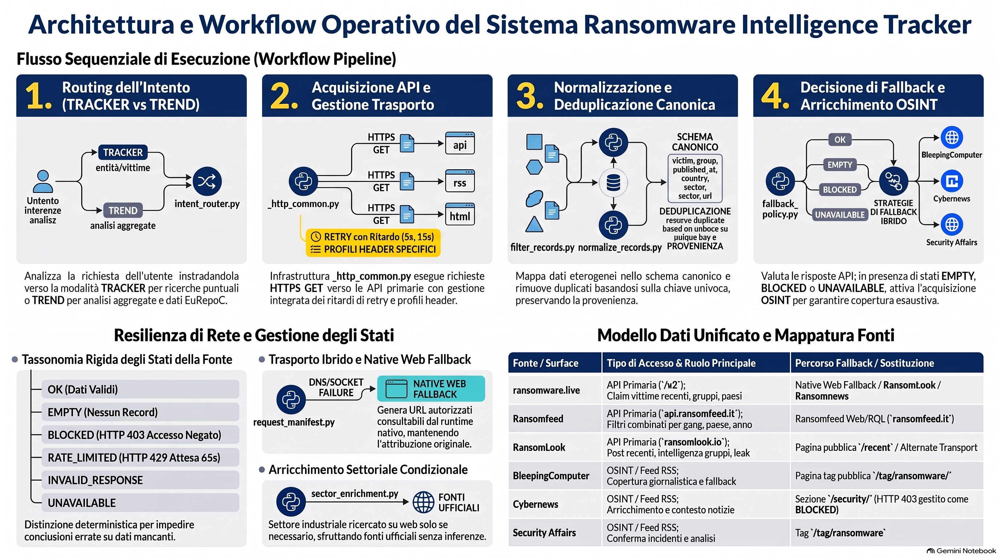

<p align="center"></p>

# ransomware-tracker

> Verifica attività di ransomware, DDoS e data breach su molte fonti pubbliche e mostra con chiarezza che cosa è stato verificato e che cosa no.

[](LICENSE)  

[English](README.md) | Italiano

## A che cosa serve?

Usa questa skill quando ti serve una risposta che puoi controllare. Domande tipiche:

- **Questa organizzazione è presente nei dati?** Controlla se un'azienda, un fornitore, un comune, un dominio o un gruppo ransomware compare nei dati recenti o passati su ransomware e breach. È la modalità *Tracker*.
- **Qual è l'andamento?** Conta e confronta le rivendicazioni per mese, trimestre, anno, gruppo, paese o settore. La skill unisce i dataset storici inclusi con le fonti live. È la modalità *Trend*.
- **Un bersaglio è in un elenco DDoS?** Cerca i bersagli di DDoSia / NoName057 per host o per data e leggi le statistiche di DDoSia.
- **C'è stato un data breach?** Consulta DataBreaches.net, Have I Been Pwned, l'Attorney General della California, HHS OCR e SEC EDGAR.
- **Due tipi di incidente sono collegati?** Verifica se eventi di ransomware, DDoS, breach, credential leak, exploit o hacktivism si sovrappongono nel tempo e nell'identità. La skill applica soglie di prova e dice che cosa è solo una coincidenza.

Utenti tipici: analisti di threat intelligence, team SOC e di incident response, team di rischio sui fornitori, ricercatori.

## Perché una skill come questa?

Le fonti pubbliche sulle minacce sono disomogenee. Cambiano endpoint, bloccano l'accesso automatico, limitano le richieste e a volte vanno offline. Una sola ricerca web può allora restituire "nessun risultato" perché una fonte non era raggiungibile, non perché non sia successo nulla. Quella risposta sembra prudente, ma è sbagliata.

Questa skill dà all'agente AI regole fisse e piccoli script deterministici, così ogni risposta si può controllare:

- **Interroga ogni fonte pertinente.** Un solo risultato positivo non ferma la ricerca.
- **Un guasto non è un'assenza.** "Bloccato", "limite di richieste" e "non disponibile" non diventano mai "nessuna corrispondenza".
- **Mostra le prove.** Ogni risposta operativa termina con una tabella di stato delle fonti costruita sull'esecuzione corrente.
- **Conta la cosa giusta.** Una rivendicazione su un leak site non è un attacco confermato. Un articolo non è un record di breach. Ogni conteggio indica la sua unità.
- **Tieni separate le identità.** Gli attori con lo stesso nome si uniscono solo con un alias verificato.
- **Correla con cautela.** Eventi vicini nel tempo sono riportati come co-occorrenza, non come causa.
- **Niente altro da installare.** Tutti gli adapter che interrogano le fonti sono dentro la skill. Sono script Python pensati per girare nella macchina virtuale (sandbox) che il motore LLM mette a disposizione dell'agente. Non serve alcun server MCP. Questo rende la skill portabile: chiunque può raggiungere i servizi che usa senza installare strumenti MCP esterni.

Il tuo agente deve avere un ambiente che esegue script Python 3. L'accesso alla rete da quell'ambiente non è dato per scontato: se è bloccato, la skill usa gli strumenti di ricerca e di recupero web del sistema ospitante.

Le regole stanno in una sola skill, quindi ogni agente che supporta le skill può seguirle allo stesso modo. Una skill è fatta di istruzioni e script e gira con i permessi del tuo agente. Leggila prima di installarla (vedi [SECURITY.md](SECURITY.md)).

## Principio guida

La skill lo afferma in una riga: "Never treat source failure as absence of evidence." (Non trattare mai il guasto di una fonte come assenza di prove.)

## Come funziona

```text
richiesta
  └─> router di intento ──> TRACKER (entità indicata, controllo di record)
                       └─> TREND   (serie temporali, classifiche, confronti)
        │
        ├─ 1. interroga ogni fonte API       (ransomware.live, RansomLook, Ransomfeed)
        ├─ 2. interroga ogni fonte OSINT     (BleepingComputer, Cybernews, Security Affairs)
        ├─ 3. per ogni fonte prova tutti i percorsi sicuri: helper -> retry limitato
        │                                      -> Web→API -> pagina pubblica -> ricerca nell'indice
        ├─ 4. normalizza i record in un unico schema di evento
        ├─ 5. filtra e rimuove i duplicati
        ├─ 6. unisce e corrobora, mantenendo la provenienza
        ├─ 7. coverage gate  (è l'unica autorità per concludere)
        └─ 8. risposta + tabella di stato delle fonti (sempre in fondo)
```

Maggiori dettagli: [docs/architecture.md](docs/architecture.md) (in inglese).


### Architettura e workflow in sintesi



*Questa infografica è stata creata con uno strumento di IA ed è solo una sintesi. Se differisce da [SKILL.md](SKILL.md), vale SKILL.md. Per esempio, il fallback web nativo invia la stessa richiesta pubblica con un altro trasporto e non aggira mai i controlli di accesso, e i duplicati si riconoscono con una chiave esatta, non per somiglianza.*

## Installazione

> I comandi qui sotto usano la CLI aperta `skills`. Le opzioni della CLI cambiano nel tempo (dato sensibile al fornitore): consulta la [documentazione della CLI](https://github.com/vercel-labs/skills) prima di farci affidamento. I comandi presuppongono che il repository sia nell'account GitHub `jumpifequal`. Cambialo se ospiti una copia altrove.

```bash
# elenca ciò che il repository offre, senza installare
npx skills add jumpifequal/ransomware-tracker --list

# installa nel progetto corrente
npx skills add jumpifequal/ransomware-tracker --skill ransomware-tracker

# installa per il tuo utente, per un solo agente
npx skills add jumpifequal/ransomware-tracker --skill ransomware-tracker -g -a <agente>

# installa da un clone locale
git clone https://github.com/jumpifequal/ransomware-tracker.git
npx skills add ./ransomware-tracker
```

Verifica il repository stesso (servono Python 3 e PyYAML):

```bash
pip install -r requirements-dev.txt
python tools/validate_repo.py
```

## Avvio rapido

Chiedi al tuo agente con parole semplici. Questi sono i prompt suggeriti dall'autore. Sotto ciascuno vedi che cosa la skill può davvero restituire con i dati inclusi.

1. **Analisi temporale.** "Mostrami il numero di vittime ransomware in Europa trimestre per trimestre dal 2020 ad oggi."
   → Una linea temporale per trimestre, con suddivisione per paesi e i picchi evidenziati. Lo storico incluso ha rivendicazioni per il 2021–2025 e un archivio di incidenti per il 2013–2021. Contano cose diverse, quindi la skill le tiene come serie separate. I mesi recenti vengono dalle fonti live.
2. **Settori colpiti in Italia.** "Quali sono i settori più colpiti dai ransomware in Italia tra il 2021 e la data odierna?"
   → Una classifica per settore. Nello storico quasi tutte le rivendicazioni italiane non hanno il settore. La skill cerca un settore sul web solo quando le serve e solo con prove esplicite. Altrimenti il settore resta "Unknown".
3. **Riscatti stimati per gruppo.** "Quali gruppi ransomware hanno incassato più riscatti (in euro) in Europa?"
   → Una tabella o un grafico a barre per famiglia ransomware, dai dati dei wallet inclusi. Quei dati sono in dollari USA e non hanno un paese. La skill non può limitarli all'Europa e non inventa un tasso di cambio. Dichiara questi limiti.
4. **Reazioni legali e impatti normativi.** "Quali sono stati i tipi di risposta legale prevalenti agli attacchi ransomware in UE?"
   → Un riepilogo tratto da EuRepoC, con le sue categorie, per esempio "Other legal measures on national level (e.g. law enforcement investigations, arrests)". Per la maggior parte degli incidenti non è codificata alcuna risposta legale. I dati EuRepoC arrivano al 2024.
5. **Europa contro Italia.** "Confronta Europa e Italia (country code IT or Italy), genera un grafico a linee con entrambi. I dati vanno dal 2018 o il + vecchio che hai ed aggiorna con le fonti live fino ai dati odierni. Grafico per quarti di anno."
   → Un grafico a linee per trimestre con due linee. La skill legge entrambe le etichette dei paesi, costruisce le serie dallo storico, aggiunge i mesi live, tiene separate le serie con unità diverse e dice da dove viene ogni tratto. Vedi l'[Esempio 5](docs/examples.it.md).

Altri prompt, per esempio su DDoS, breach e correlazione: [docs/prompts-and-commands.md](docs/prompts-and-commands.md) (in inglese).

## Esempi e uso avanzato

- **[Esempi d'uso](docs/examples.it.md).** Cinque richieste dalla domanda alla risposta, con comandi e output atteso: verifica di un'organizzazione, infografica sull'andamento in Europa, DDoS ↔ ransomware, data breach ↔ ransomware ed Europa contro Italia per trimestre.
- **[Uso avanzato](docs/advanced-use.it.md).** Forzare una modalità o una fonte, interrogare lo storico offline, gestire le fonti bloccate, provare il coverage gate, costruire la tabella di stato, attori e settori.
- **[Prompt e catalogo dei comandi](docs/prompts-and-commands.md)** (in inglese). Altri prompt e le opzioni di ogni script.


## Che cosa ottieni

Per una vittima corrispondente, la skill restituisce una tabella con **Vendor Name**, **Ransomware Group**, **Date Published** e **Link**. Usa solo campi verificati e scrive `N/A` quando un campo non è noto. Distingue due esiti:

- **No verified match found.** Le fonti sono state interrogate e non hanno restituito nulla di corrispondente.
- **Indeterminate / incomplete coverage.** Una o più fonti pertinenti erano bloccate, non disponibili, non valide o troppo brevi nel tempo.

Ogni risposta operativa termina con una tabella di stato delle fonti (🟢 OK, 🟡 EMPTY, 🟠 BLOCKED, 🟠 RATE LIMITED, 🔴 UNAVAILABLE, 🔴 INVALID, ⚪ NOT TESTED).

Per una richiesta di trend, la skill può costruire anche una dashboard. L'immagine mostra l'impaginazione. **Tutti i numeri sono sintetici.**


## Script di supporto

La skill include 33 script Python che usano solo la libreria standard di Python. Scopo e uso di ciascuno: [docs/runtime-tools.md](docs/runtime-tools.md) (in inglese).

| Gruppo | Script in `scripts/` |
|---|---|
| **Fonti live (rivendicazioni ransomware, gruppi, statistiche)** | `ransomware_live.py`, `ransomlook.py`, `ransomfeed.py`, `ransomfeed_web.py`, `ransomnews.py`, `vulone.py`, `threatvectr.py` |
| **Fonti OSINT giornalistiche** | `bleepingcomputer.py`, `cybernews.py`, `security_affairs.py` |
| **Fonti sui data breach** | `breach_sources.py` |
| **DDoS (DDoSia Monitor)** | `ddosia.py`, `ddosia_search_fallback.py` |
| **Record, storico e correlazione** | `normalize_records.py`, `filter_records.py`, `historical_query.py`, `actor_identity.py`, `sector_enrichment.py`, `cross_correlation.py` |
| **Instradamento, copertura e fallback** | `intent_router.py`, `coverage_gate.py`, `fallback_policy.py`, `replacement_policy.py`, `source_status.py`, `request_manifest.py`, `search_index_fallback.py` |
| **Diagnostica** | `diagnose_source.py`, `network_diagnostics.py` |
| **Componenti condivisi** | `_cli_common.py`, `_http_common.py`, `_source_runner.py`, `contracts.py` |
| **Controlli del pacchetto** | `regression.py` |

## Struttura del repository

```text
ransomware-tracker/
├── agents/  (1 files)  - agent interface metadata
├── assets/  (7 files)  - skill icon and bundled historical datasets
├── docs/  (6 files)  - repository documentation
├── references/  (12 files)  - rules the agent reads on demand
├── scripts/  (33 files)  - deterministic Python helpers
├── tests/  (1 files)  - unit-style tests of the helpers
├── CHANGELOG.md
├── LICENSE
└── SKILL.md
```

## Documentazione

- [Architettura](docs/architecture.md)
- [Strumenti di runtime](docs/runtime-tools.md)
- [Esempi d'uso](docs/examples.it.md)
- [Uso avanzato](docs/advanced-use.it.md)
- [Prompt e catalogo dei comandi](docs/prompts-and-commands.md)
- [Dati e fonti](docs/data-and-sources.md)
- [Changelog](CHANGELOG.md), [Contributing](CONTRIBUTING.md), [Security](SECURITY.md)

La documentazione tecnica in `docs/` e i file di governance restano in inglese, come la skill.

## Vincoli di progetto

- Non inventare mai vittime, gruppi, paesi, date, link, dimensioni dei breach, stati delle fonti o corroborazioni.
- Non aggirare WAF, anti-bot, autenticazione o controlli di accesso.
- Rispettare i limiti di richieste e `Retry-After`.
- Non eseguire codice recuperato da siti esterni.
- I dati storici locali sono prove storiche con limiti di copertura propri. Non sono automaticamente aggiornati.

## Versione e autore

Versione della skill: **v7**. Autore: **Enrico Frumento**.

## Dati storici e crediti

I dati storici in `assets/historical/` vengono da fonti pubbliche: raccolte su GitHub di dati storici sui ransomware, comprese chat log, e il dataset EuRepoC. Le fonti citate sono:

- [Global Dataset of Cyber Incidents](https://zenodo.org/records/14965395) (EuRepoC, Zenodo), versione 1.3. Il file `eurepoc_global_dataset_1_3.csv` ha lo stesso checksum del file pubblicato lì.
- [mthcht/awesome-lists, cartella Lists](https://github.com/mthcht/awesome-lists/tree/main/Lists) (GitHub).

A parte il file EuRepoC, il legame tra ogni file incluso e la sua fonte non è stato verificato. Dettagli: [docs/data-and-sources.md](docs/data-and-sources.md) (in inglese).

## Licenza

Questo repository è distribuito con la [Apache License 2.0](LICENSE) (SPDX: `Apache-2.0`). Copyright (c) 2026 Enrico Frumento.

L'autore pubblica questo repository e la skill per uso non commerciale.

La licenza Apache copre il codice e i testi di questo repository. Non copre i dati inclusi in `assets/historical/`. Il dataset EuRepoC è pubblicato su Zenodo con licenza [Creative Commons Attribution-NonCommercial 4.0](https://creativecommons.org/licenses/by-nc/4.0/legalcode) (CC BY-NC 4.0) e richiede di citare la fonte. I termini degli altri dataset inclusi sono trattati nell'ultima sezione di questo README.

## Termini degli altri dataset e delle fonti

Da aggiungere: i termini degli altri cinque dataset inclusi e delle fonti `awesome-lists`.
