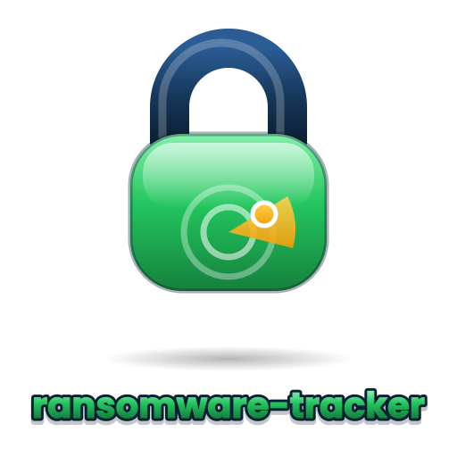
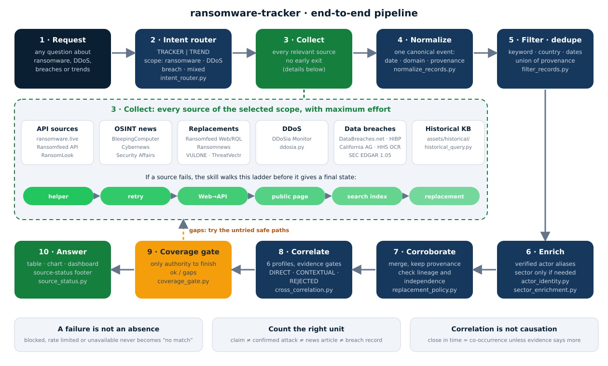
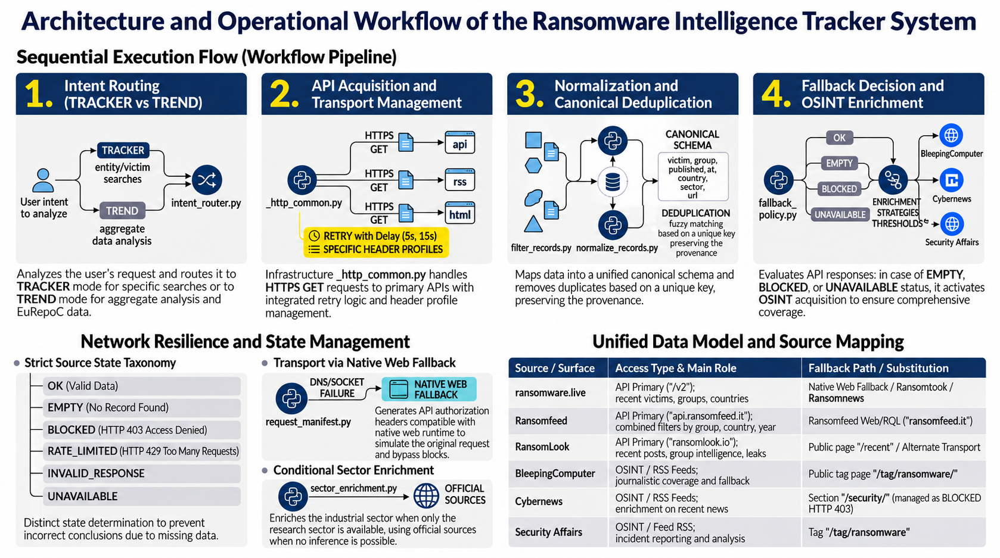

<p align="center"></p>

# ransomware-tracker

> Check ransomware, DDoS and data-breach activity across many public sources, and see exactly what was verified and what was not.

[](LICENSE)  

English | [Italiano](README.it.md)

## What is it useful for?

Use this skill when you need an answer you can check. Typical questions:

- **Is this organization listed?** Check if a named company, vendor, municipality, domain or ransomware group appears in recent or past ransomware and breach data. This is *Tracker* mode.
- **What is the trend?** Count and compare claims by month, quarter, year, group, country or sector. The skill combines bundled historical datasets with live sources. This is *Trend* mode.
- **Is a target on a DDoS list?** Look up DDoSia / NoName057 targets by host or date, and read DDoSia statistics.
- **Was there a data breach?** Check DataBreaches.net, Have I Been Pwned, the California Attorney General, HHS OCR and SEC EDGAR.
- **Are two kinds of incident linked?** Test if ransomware, DDoS, breach, credential-leak, exploit or hacktivism events overlap in time and identity. The skill applies evidence gates and says what is only coincidence.

Typical users: threat-intelligence analysts, SOC and incident-response teams, third-party-risk teams and researchers.

## Why a skill like this?

Public threat sources are uneven. They change endpoints, block automated access, limit request rates and sometimes go offline. A single web search can then return "no results" because a source could not be reached, not because nothing happened. That answer looks safe, but it is wrong.

This skill gives the AI agent fixed rules and small deterministic scripts, so every answer can be checked:

- **Ask every relevant source.** One positive hit never stops the search.
- **A failure is not an absence.** "Blocked", "rate limited" and "unavailable" are never turned into "no match".
- **Show the evidence.** Every operational answer ends with a source-status table built from the current run.
- **Count the right thing.** A leak-site claim is not a confirmed attack. A news article is not a breach record. Every count names its unit.
- **Keep identities apart.** Actors with the same name are merged only through a verified alias.
- **Correlate with care.** Events close in time are reported as co-occurrence, not as cause.
- **Nothing else to install.** All the adapters that query the sources are inside the skill. They are Python scripts built to run in the virtual machine (sandbox) that the LLM engine gives to the agent. You do not need any MCP server. This makes the skill portable: anyone can reach the services it uses without installing external MCP tools.

Your agent needs a runtime that can run Python 3 scripts. Network access from that runtime is not assumed: if it is blocked, the skill uses the host's own web search and fetch tools instead.

The rules sit in one skill, so any agent that supports skills can follow them in the same way. A skill is instructions plus scripts, and it runs with the permissions of your agent. Read it before you install it (see [SECURITY.md](SECURITY.md)).

## Governing principle

The skill states it in one line: "Never treat source failure as absence of evidence."

## How it works

```text
request
  └─> intent router ──> TRACKER (named entity, record check)
                    └─> TREND   (time series, rankings, comparisons)
        │
        ├─ 1. query every API source        (ransomware.live, RansomLook, Ransomfeed)
        ├─ 2. query every OSINT source      (BleepingComputer, Cybernews, Security Affairs)
        ├─ 3. per source, try all safe paths: helper -> bounded retry -> Web→API
        │                                      -> public page -> search-index recovery
        ├─ 4. normalize records to one canonical event schema
        ├─ 5. filter and de-duplicate
        ├─ 6. merge and corroborate, keeping provenance
        ├─ 7. coverage gate  (the only authority to finish)
        └─ 8. answer + source-status table (always last)
```

More detail: [docs/architecture.md](docs/architecture.md).



### Architecture and workflow at a glance



*This infographic was made with an AI tool and is only a summary. If it differs from [SKILL.md](SKILL.md), follow SKILL.md. For example, the native web fallback only sends the same public request through another transport and never bypasses access controls, and duplicates are matched on an exact key, not by fuzzy matching.*

## Install

> The commands below use the open `skills` CLI. CLI options change over time (vendor-sensitive): check the [CLI documentation](https://github.com/vercel-labs/skills) before you rely on them. The commands assume the repository lives under the GitHub account `jumpifequal`. Change it if you host a copy elsewhere.

```bash
# list what the repository offers, without installing
npx skills add jumpifequal/ransomware-tracker --list

# install in the current project
npx skills add jumpifequal/ransomware-tracker --skill ransomware-tracker

# install for your user, for one agent
npx skills add jumpifequal/ransomware-tracker --skill ransomware-tracker -g -a <agent>

# install from a local clone
git clone https://github.com/jumpifequal/ransomware-tracker.git
npx skills add ./ransomware-tracker
```

Check the repository itself (needs Python 3 and PyYAML):

```bash
pip install -r requirements-dev.txt
python tools/validate_repo.py
```

## Quick start

Ask your agent in plain words. These are the prompts the author suggests (the Italian originals are in the [Italian README](README.it.md)). Under each one you see what the skill can really deliver with the bundled data.

1. **Trend over time.** "Show me the number of ransomware victims in Europe, quarter by quarter, from 2020 to today."
   → A line chart by quarter, split by country, with the peaks marked. The bundled history has claims for 2021–2025 and an incident repository for 2013–2021. They count different things, so the skill keeps them as separate series. The recent months come from live sources.
2. **Sectors hit in Italy.** "Which sectors were hit most by ransomware in Italy between 2021 and today?"
   → A ranking by sector. Most historical Italian claims have no sector. The skill looks up a sector on the web only when it needs one, and only with explicit evidence. Otherwise the sector stays "Unknown".
3. **Ransom amounts by group.** "Which ransomware groups collected the most ransom (in euros) in Europe?"
   → A table or bar chart by ransomware family, from the bundled wallet data. That data is in US dollars and has no country. The skill cannot limit it to Europe and does not invent an exchange rate. It states these limits.
4. **Legal responses in the EU.** "Which types of legal response to ransomware attacks were most common in the EU?"
   → A summary from EuRepoC, with its own categories, for example "Other legal measures on national level (e.g. law enforcement investigations, arrests)". For most incidents no legal response is coded. The EuRepoC data ends in 2024.
5. **Europe against Italy.** "Compare Europe and Italy (country code IT or Italy) and draw a line chart with both. Use data from 2018, or the oldest you have, and update it with the live sources up to today. Quarterly chart."
   → A line chart by quarter with two lines. The skill reads both country labels, builds the series from the history first, adds the live months, keeps series with different units apart, and says where each segment comes from. See [Example 5](docs/examples.md).

More prompts, for example for DDoS, breaches and correlation: [docs/prompts-and-commands.md](docs/prompts-and-commands.md).

## Examples and advanced use

- **[Worked examples](docs/examples.md).** Five requests from question to answer, with commands and expected output: check one organization, a trend infographic for Europe, DDoS ↔ ransomware, data breach ↔ ransomware, and Europe against Italy by quarter.
- **[Advanced use](docs/advanced-use.md).** Force a mode or a source, query the history offline, handle blocked sources, test the coverage gate, build the status table, actors and sectors.
- **[Prompts and command catalogue](docs/prompts-and-commands.md).** More prompts and the options of every helper script.

## What you get back

For a matching victim, the skill returns a table with **Vendor Name**, **Ransomware Group**, **Date Published** and **Link**. It uses only verified fields and writes `N/A` when a field is not known. It separates two outcomes:

- **No verified match found.** The sources were queried and returned nothing that matches.
- **Indeterminate / incomplete coverage.** One or more relevant sources were blocked, unavailable, invalid or too short in time.

Every operational answer ends with a source-status table (🟢 OK, 🟡 EMPTY, 🟠 BLOCKED, 🟠 RATE LIMITED, 🔴 UNAVAILABLE, 🔴 INVALID, ⚪ NOT TESTED).

For a trend request, the skill can also build a dashboard. This picture shows the layout. **All numbers in it are synthetic.**


## Helper scripts

The skill ships 33 Python helpers that use only the Python standard library. Purpose and use of each one: [docs/runtime-tools.md](docs/runtime-tools.md).

| Group                                                    | Scripts in `scripts/`                                                                                                                                        |
| -------------------------------------------------------- | ------------------------------------------------------------------------------------------------------------------------------------------------------------ |
| **Live sources (ransomware claims, groups, statistics)** | `ransomware_live.py`, `ransomlook.py`, `ransomfeed.py`, `ransomfeed_web.py`, `ransomnews.py`, `vulone.py`, `threatvectr.py`                                  |
| **OSINT news sources**                                   | `bleepingcomputer.py`, `cybernews.py`, `security_affairs.py`                                                                                                 |
| **Data-breach sources**                                  | `breach_sources.py`                                                                                                                                          |
| **DDoS (DDoSia Monitor)**                                | `ddosia.py`, `ddosia_search_fallback.py`                                                                                                                     |
| **Records, history and correlation**                     | `normalize_records.py`, `filter_records.py`, `historical_query.py`, `actor_identity.py`, `sector_enrichment.py`, `cross_correlation.py`                      |
| **Routing, coverage and fallback**                       | `intent_router.py`, `coverage_gate.py`, `fallback_policy.py`, `replacement_policy.py`, `source_status.py`, `request_manifest.py`, `search_index_fallback.py` |
| **Diagnostics**                                          | `diagnose_source.py`, `network_diagnostics.py`                                                                                                               |
| **Shared building blocks**                               | `_cli_common.py`, `_http_common.py`, `_source_runner.py`, `contracts.py`                                                                                     |
| **Package checks**                                       | `regression.py`                                                                                                                                              |

## Repository layout

```text
ransomware-tracker/
├── agents/  (1 files)  - agent interface metadata
├── assets/  (7 files)  - skill icon and bundled historical datasets
├── docs/  (6 files)  - repository documentation
├── references/  (12 files)  - rules the agent reads on demand
├── scripts/  (33 files)  - deterministic Python helpers
├── tests/  (1 files)  - unit-style tests of the helpers
├── CHANGELOG.md
├── LICENSE
└── SKILL.md
```

## Documentation

- [Architecture](docs/architecture.md)
- [Runtime tools](docs/runtime-tools.md)
- [Worked examples](docs/examples.md)
- [Advanced use](docs/advanced-use.md)
- [Prompts and command catalogue](docs/prompts-and-commands.md)
- [Data and sources](docs/data-and-sources.md)
- [Changelog](CHANGELOG.md), [Contributing](CONTRIBUTING.md), [Security](SECURITY.md)

## Design constraints

- Never invent victims, groups, countries, dates, links, breach sizes, source states or corroboration.
- Do not bypass WAF, anti-bot, authentication or access controls.
- Respect rate limits and `Retry-After`.
- Do not run code retrieved from external sites.
- Local historical data is historical evidence with its own coverage limits. It is not automatically current.

## Historical data and credits

The historical data in `assets/historical/` come from public sources: GitHub collections of historical ransomware data, including chat logs, and the EuRepoC dataset. The sources cited are:

- [Global Dataset of Cyber Incidents](https://zenodo.org/records/14965395) (EuRepoC, Zenodo), version 1.3. The file `eurepoc_global_dataset_1_3.csv` has the same checksum as the file published there.
- [mthcht/awesome-lists, folder Lists](https://github.com/mthcht/awesome-lists/tree/main/Lists) (GitHub).

Apart from the EuRepoC file, the link between each bundled file and its source was not checked. Details: [docs/data-and-sources.md](docs/data-and-sources.md).

## License

This repository is licensed under the [Apache License 2.0](LICENSE) (SPDX: `Apache-2.0`). Copyright (c) 2026 Enrico Frumento.

The author publishes this repository and the skill for non-commercial use.

The Apache License covers the code and the text of this repository. It does not cover the bundled data in `assets/historical/`. The EuRepoC dataset is published on Zenodo under [Creative Commons Attribution-NonCommercial 4.0](https://creativecommons.org/licenses/by-nc/4.0/legalcode) (CC BY-NC 4.0), and credit to the source is required. The terms of the other bundled datasets are covered in the last section of this README.

## Terms of the other datasets and sources

To be added: the terms of the other five bundled datasets and of the `awesome-lists` sources.
