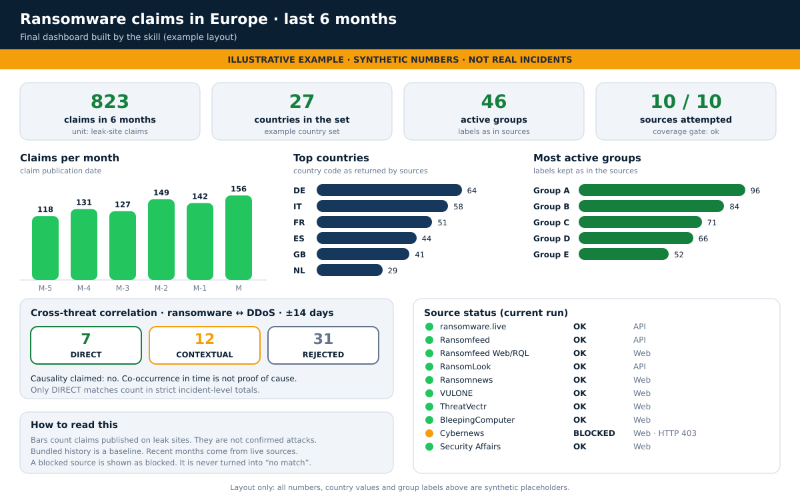

[README](../README.it.md) · [Esempi d'uso](examples.it.md) · [Uso avanzato](advanced-use.it.md) · [Prompt e comandi](prompts-and-commands.md) (in inglese)

# Esempi d'uso

Ogni esempio mostra la richiesta, che cosa fa la skill dietro le quinte, i comandi che può eseguire e l'output atteso. Esegui i comandi dalla radice del repository. Gli output indicati come *reali* sono stati prodotti dagli script. Nomi, numeri e tabelle indicati come *esempio* sono segnaposto, non incidenti reali.

## Esempio 1 · Verificare una singola organizzazione (Tracker)

**Chiedi:** "Usa $ransomware-tracker per verificare se *Example Corp* compare nelle rivendicazioni ransomware recenti."

**Che cosa succede**

1. Il router sceglie la modalità Tracker e l'ambito ransomware.

   ```bash
   python scripts/intent_router.py "is Example Corp listed in recent ransomware claims"
   ```

   *Output reale (abbreviato):* `{"mode":"TRACKER", ... "threat_scope":"RANSOMWARE", ...}`

2. L'agente interroga ogni fonte API e OSINT. Alcuni comandi:

   ```bash
   python scripts/ransomware_live.py search "Example Corp"
   python scripts/ransomlook.py search "Example Corp"
   python scripts/ransomfeed.py combined --keyword "Example Corp" --limit 100
   python scripts/bleepingcomputer.py search "Example Corp"
   python scripts/cybernews.py search "Example Corp"
   python scripts/security_affairs.py search "Example Corp"
   ```

3. I record sono normalizzati in un solo schema, filtrati e privati dei duplicati (vedi Esempio 2).

4. Il coverage gate verifica che ogni fonte pertinente sia stata tentata. Se una manca, l'esecuzione continua.

5. L'agente scrive la risposta.

**Output atteso (esempio):**

| Vendor Name    | Ransomware Group | Date Published | Link                             |
| -------------- | ---------------- | -------------- | -------------------------------- |
| *Example Corp* | *ExampleGroup*   | *2026-09-03*   | *https://example.invalid/record* |

La risposta termina con la tabella di stato delle fonti (vedi la dashboard più sotto). Se nessuna fonte corrisponde, la skill scrive **No verified match found**. Se una fonte pertinente era bloccata o non disponibile, scrive invece **Indeterminate / incomplete coverage**.

## Esempio 2 · Infografica: andamento del ransomware in Europa, ultimi 6 mesi (Trend)

**Chiedi:** "Crea un'infografica sull'andamento degli attacchi ransomware in Europa negli ultimi 6 mesi."

**Che cosa succede**

1. Il router sceglie la modalità Trend.

   ```bash
   python scripts/intent_router.py "create an infographic of ransomware attack trends in Europe for the last 6 months"
   ```

   *Output reale (abbreviato):* `{"mode":"TREND", ... "threat_scope":"RANSOMWARE", "reason":"aggregation/historical/financial/legal intent"}`

2. L'agente raccoglie i dati live mese per mese e paese per paese. "Europa" è un insieme di codici paese che l'agente sceglie e dichiara.

   ```bash
   python scripts/ransomware_live.py month <YYYY> <M>          # ripeti per ciascuno dei 6 mesi
   python scripts/ransomware_live.py country <CC>              # ripeti per ogni codice paese dell'insieme
   python scripts/ransomfeed.py combined --country <CC> --year <YYYY> --limit 200
   python scripts/threatvectr.py month <YYYY> <M>              # solo controllo di coerenza sugli aggregati
   ```

3. L'agente aggiunge una base storica dai dati inclusi. Le rivendicazioni incluse arrivano al 2025, quindi i mesi recenti vengono dalle fonti live.

   ```bash
   python scripts/historical_query.py claims --group-by year
   ```

   *Output reale:* `{"ok":true,"mode":"claims","count":3079,"data":[{"bucket":"2021","count":7},{"bucket":"2022","count":22},{"bucket":"2023","count":872},{"bucket":"2024","count":1118},{"bucket":"2025","count":1060}]}`

4. Ogni risposta live è normalizzata e filtrata. I due script leggono JSON dallo standard input, quindi si concatenano con le pipe.

   ```bash
   python scripts/ransomware_live.py month <YYYY> <M> \
     | python scripts/normalize_records.py --source ransomware.live \
     | python scripts/filter_records.py --country <CC> --date-from <YYYY-MM-DD> --date-to <YYYY-MM-DD>
   ```

   *Output reale per un record segnaposto (abbreviato):* `{"ok":true,"count":1,"records":[{"victim":"Example Corp","group":"examplegroup","date":"2026-09-03 10:00:00","date_semantics":"discovery_date","country":"IT","data_type":"ransomware-claim-record","provenance":["ransomware.live"], ...}],"filters":{...}}`

5. L'agente raggruppa per mese e paese, tiene separati i conteggi dei tracker quando differiscono e dichiara l'unità che conta (rivendicazioni, non attacchi confermati).

6. Il coverage gate e la tabella di stato chiudono l'esecuzione.

**Output atteso:** una breve sintesi, tabelle e un grafico o una dashboard, se il tuo agente sa disegnarli. L'immagine qui sotto mostra l'impaginazione. **Tutti i numeri sono sintetici.**



## Esempio 3 · DDoS e ransomware sono collegati? (cross-threat)

**Chiedi:** "Le rivendicazioni ransomware e i bersagli DDoS si sovrappongono per *example.org* nell'ultimo trimestre?"

**Che cosa succede**

1. Il router vede entrambe le famiglie di minacce e imposta l'ambito `MIXED`.

   ```bash
   python scripts/intent_router.py "do ransomware and DDoS overlap for example.org"
   ```

   *Output reale (abbreviato):* `{"mode":"TRACKER", ... "threat_scope":"MIXED", ...}`

2. L'agente legge il lato DDoS da DDoSia Monitor e il lato ransomware come nell'Esempio 1.

   ```bash
   python scripts/ddosia.py search example.org
   python scripts/ddosia.py recent --limit 50
   python scripts/ddosia.py date <YYYY-MM-DD>
   python scripts/ddosia.py stats overview
   ```

3. L'agente correla le due liste con un profilo. La finestra predefinita per ransomware ↔ DDoS è ±14 giorni. `cross_correlation.py` è un modulo Python, quindi lo chiami da Python:

   ```bash
   PYTHONPATH=scripts python - <<'PY'
   import cross_correlation as c
   r = c.correlate("ransomware_ddos",
       [{"victim": "Example Corp", "date": "2026-09-01"}],
       [{"organization": "EXAMPLE CORP", "date": "2026-09-09"}])
   m = r["matches"][0]
   print(r["tolerance_days"], r["match_count"], r["direct_match_count"], r["causality_claimed"])
   print(m["relation_type"], m["delta_days"], m["confidence"])
   PY
   ```

   *Output reale:*

   ```text
   14 1 1 False
   temporal_cooccurrence 8.0 medium
   ```

**Output atteso:** un elenco di corrispondenze con il livello di prova (`DIRECT`, `CONTEXTUAL` o `REJECTED`), la data usata, la distanza in giorni e il tipo di relazione. La skill dichiara che non afferma alcuna causalità. Solo le corrispondenze `DIRECT` entrano nei totali rigorosi a livello di incidente.

## Esempio 4 · Data breach e ransomware insieme

**Chiedi:** "*Example Hospital* è in un record di data breach e corrisponde a una rivendicazione ransomware?"

```bash
python scripts/breach_sources.py databreaches search "Example Hospital"
python scripts/breach_sources.py hibp latest
python scripts/breach_sources.py hibp breaches
```

Le altre fonti di breach sono `california`, `hhs` e `sec`. Il profilo ransomware ↔ data breach (`ransomware_data_breach`) usa una finestra di ±30 giorni. La skill tiene separate la data dell'incidente, di pubblicazione, di deposito e di catalogo, e tiene separata la cifratura ransomware dall'estorsione di dati.

**Output atteso:** una tabella di corrispondenze. Ogni riga mostra la classe di autorità della fonte e il significato della sua data.

## Esempio 5 · Europa contro Italia, grafico a linee per trimestre

**Chiedi:** "Confronta Europa e Italia (country code IT or Italy), genera un grafico a linee con entrambi. I dati vanno dal 2018 o il + vecchio che hai ed aggiorna con le fonti live fino ai dati odierni. Grafico per quarti di anno."

**Che cosa succede**

1. Il router sceglie la modalità Trend.

2. L'agente guarda prima le etichette dei paesi. Il prompt cita `IT` e `Italy` apposta, perché i dati inclusi usano entrambe.

   ```bash
   python scripts/historical_query.py claims --country IT --group-by country
   ```

   *Output reale:* `{"ok":true,"mode":"claims","count":79,"data":[{"bucket":"IT","count":76},{"bucket":"Italy","count":1},{"bucket":"Kuwait","count":1},{"bucket":"Switzerland","count":1}]}`

   Il filtro ha trovato anche `Kuwait` e `Switzerland`, quindi l'agente tiene solo le righe con etichetta esattamente `IT` o `Italy`.

3. L'agente costruisce lo storico in due parti, perché i dati inclusi hanno due unità diverse.

   ```bash
   python scripts/historical_query.py claims --country IT                                            # rivendicazioni, 2021–2025: record, non raggruppati
   python scripts/historical_query.py repository --location Italy --start-year 2018 --end-year 2021  # archivio di incidenti, 2013–2021
   ```

   L'helper confronta il testo, quindi l'agente elenca i record di rivendicazioni corrispondenti, tiene le etichette esatte `IT` e `Italy` e le raggruppa da sé per trimestre. Usare solo il nome dà una serie minuscola: l'*output reale* di `claims --country Italy --group-by quarter` è una sola rivendicazione (`2025-Q4`), perché la maggior parte delle rivendicazioni italiane ha l'etichetta `IT`.

   *Output reale del comando sull'archivio (abbreviato):* `{"ok":true,"mode":"repository","count":5,"data":[{"id":"622","date_began":"6/1/2020","year":2020, ...}]}`

4. L'agente sceglie l'insieme dei codici paese europei, lo dichiara e ripete i passi per ogni codice. Poi aggiunge i mesi live.

   ```bash
   python scripts/ransomware_live.py country <CC>
   python scripts/ransomfeed.py combined --country <CC> --year <YYYY> --limit 200
   ```

5. I record live passano da `normalize_records.py` e `filter_records.py` (corrispondenza esatta del paese), come nell'Esempio 2.

6. Il coverage gate e la tabella di stato chiudono l'esecuzione.

**Output atteso:** un grafico a linee con due linee, Europa e Italia, per trimestre. Ogni tratto indica da dove viene (archivio, rivendicazioni o fonti live) e che cosa conta. La skill non unisce tratti con unità diverse in un'unica linea continua senza dirlo. Il grafico termina con la tabella di stato delle fonti.
